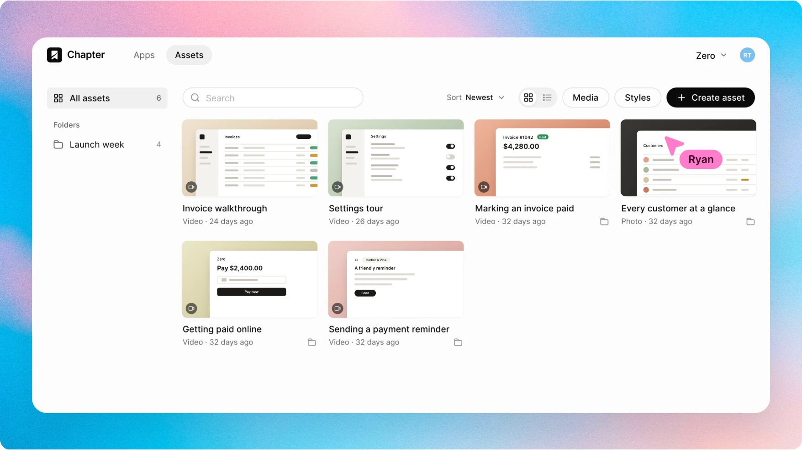
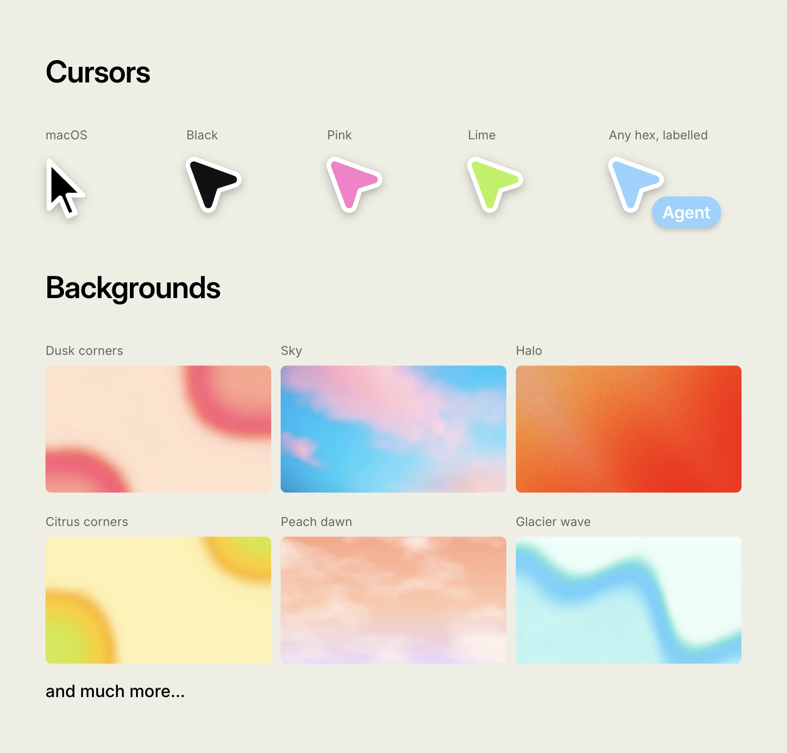

#  product-demo-agent-toolkit

[](https://www.npmjs.com/package/@chapterdev/product-demo-agent-toolkit) [](LICENSE)

### A toolkit to make beautiful product videos with your own agent

Create product videos that your customers love, with your own AI agent, and let the toolkit
handle all of the common issues that agents run into while creating demos.

<!--
  Looping demo video goes here. GitHub doesn't autoplay <video> in a README, so for a loop use a
  GIF (or an animated WebP), kept under 10MB:
  
-->



## Quickstart

```bash
npx @chapterdev/product-demo-agent-toolkit setup
```

Now ask your favorite agent to:

> Make me a walkthrough video of my product running locally, showcasing the sign up flow.

## Why do I need a toolkit?

Although your agent can drive your browser and navigate your product, we've found that it makes
certain decisions that just aren't acceptable if you want to send these videos to customers,
such as:

- **It moves like a robot.** The pointer jumps from place to place, text appears all at once,
  and nothing pauses for the viewer. The toolkit moves the pointer the way a hand does, types
  at a person's pace, and gives each result a moment on screen.
- **It doesn't know when the page is ready.** It either waits too long, filling the video
  with dead air, or acts too early, mid-load. The toolkit watches the screen itself, so it
  waits for what's loading and not a moment longer.
- **Unnatural narratives.** Left to itself, an agent makes up scenarios no real user would
  go through, with made-up data and steps that don't match how your product is used. The
  toolkit has it explore your app first, then write a script you can read and edit.
- **Voiceovers are out of sync.** Narration added afterwards never lines up. Here, the
  lines are spoken first and every click, keystroke and drag lands on its word.

So we built a toolkit to address these issues and much more.

## Tasteful Defaults



As well as:

- Background music that doesn't put your audience to sleep.
- Frames (browser, rounded borders).
- Cursor movement that feels like a real human.
- Real clicking & typing sounds.
- 1080p at 60fps.

## Customizable Config

The toolkit is ready to roll by default, but if you want to customize it, you can do that too!
Add `.product-demo/config.json` to the project. Every setting is optional, for example:

```json
{
  "backdrop": "./brand/backdrop.png",
  "display": "browser",
  "cursor": { "style": "#2855DB", "size": 1.25, "label": "Agent" },
  "sound": { "click": true, "typing": false },
  "music": { "track": "lofi", "volume": 0.3 }
}
```

| Setting    | Default                  | Takes                                                                                                                                                                                   |
| ---------- | ------------------------ | --------------------------------------------------------------------------------------------------------------------------------------------------------------------------------------- |
| `backdrop` | `"sky"`                  | One of our 22 backdrops by name (your agent knows them), a hex colour like `"#f4f1ea"`, or your own `.jpg`, `.png` or `.webp`.                                                          |
| `display`  | `"none"`                 | `"none"`, the app on the backdrop as it is, or `"browser"`, in a browser window with an address bar.                                                                                    |
| `cursor`   | `"black"`                | `"black"`, `"pink"`, `"lime"`, `"macos"`, a hex colour, or your own `.svg`. Or an object: `style`, `size` (0.5 to 3), `label`, and `tip` (`[x, y]`, for your own SVG).                  |
| `sound`    | `true`                   | Click and typing sounds: `true`, `false`, or `{ "click": true, "typing": false }`.                                                                                                      |
| `music`    | `false`                  | `"lofi"`, your own `.mp3`, `.m4a`, `.aac`, `.wav`, `.ogg` or `.flac`, or `{ "track": "lofi", "volume": 0.4 }` (0.25 by default). Looped if the video runs longer, faded out at the end. |
| `voice`    | Jessica, from ElevenLabs | Who speaks the voiceover: `{ "provider": "elevenlabs", "voice": "<voice id>" }`, and optionally a `"model"`.                                                                            |
| `mode`     | `"just_do_it"`           | When something is unclear, make the best choice and note it. `"ask"` stops and asks instead.                                                                                            |
| `keep`     | `10`                     | How many rehearsals and shoots of each film to keep.                                                                                                                                    |
| `review`   | `false`                  | Whether `cut` also makes the review image.                                                                                                                                              |

## Features

- Human feeling movement and navigation
- Voiceovers sync naturally to actions
- Highlight specific DOM elements
- Smooth camera zoom and panning
- Tasteful cursors, backdrops and audio defaults
- Handcrafted skills for how to produce great videos
- Built-in review infrastructure
- High definition recording functionality

And much more.

#### Coming soon

- Local Studio (web application for editing)
- Support for Safari and Firefox (currently only Chrome)
- More tasteful defaults
- Support for mobile product demos

## For AI agents

Asked to make a video with this toolkit? Don't clone this repository: the toolkit runs from
its npm package, not from source.

1. Run `npx @chapterdev/product-demo-agent-toolkit setup`. It installs the
   `product-demo-agent-toolkit` command and the `product-demo` skill, and prints where the
   skill went.
2. Read that skill's `SKILL.md` and follow it, in the user's project and in this session.

## Licence

MIT. The sounds are CC0, credited in [library/README.md](library/README.md).
